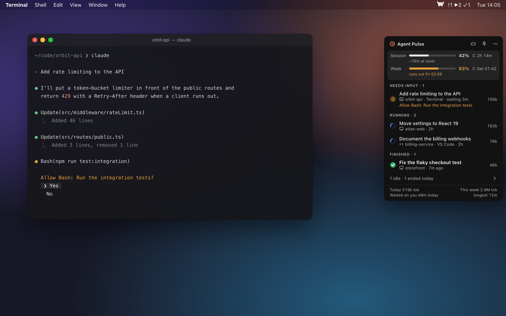
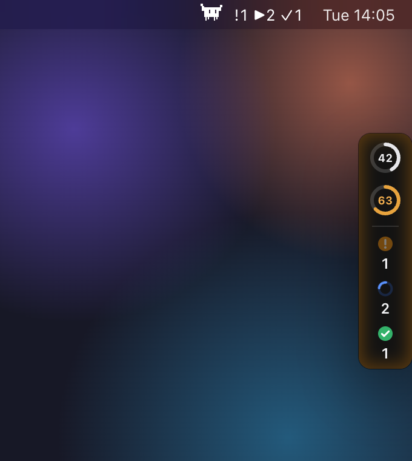
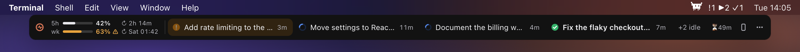
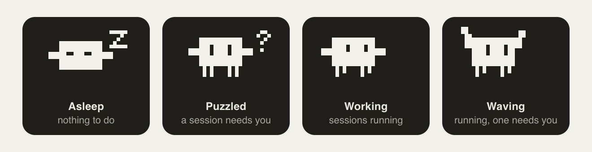
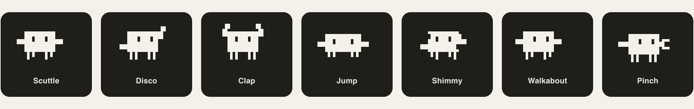
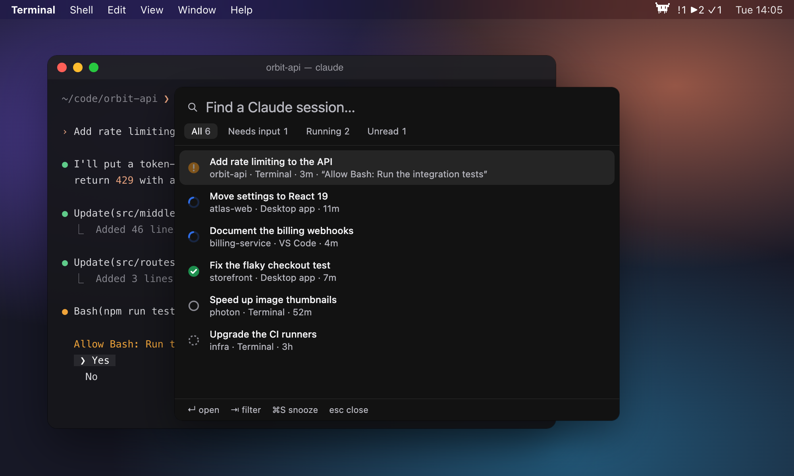
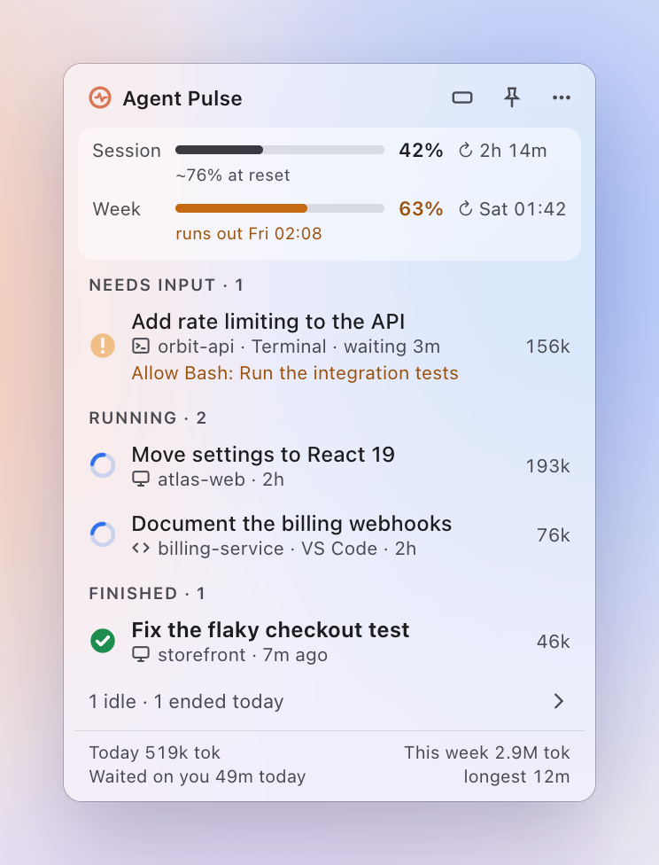
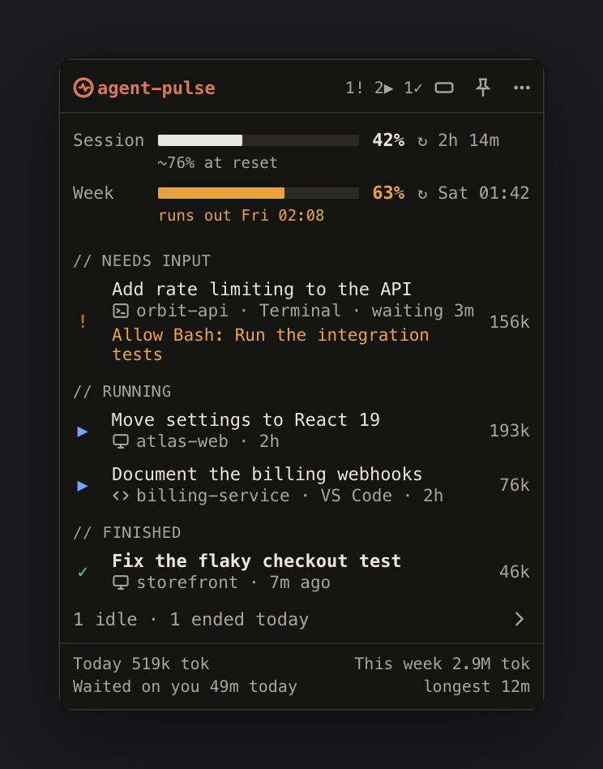
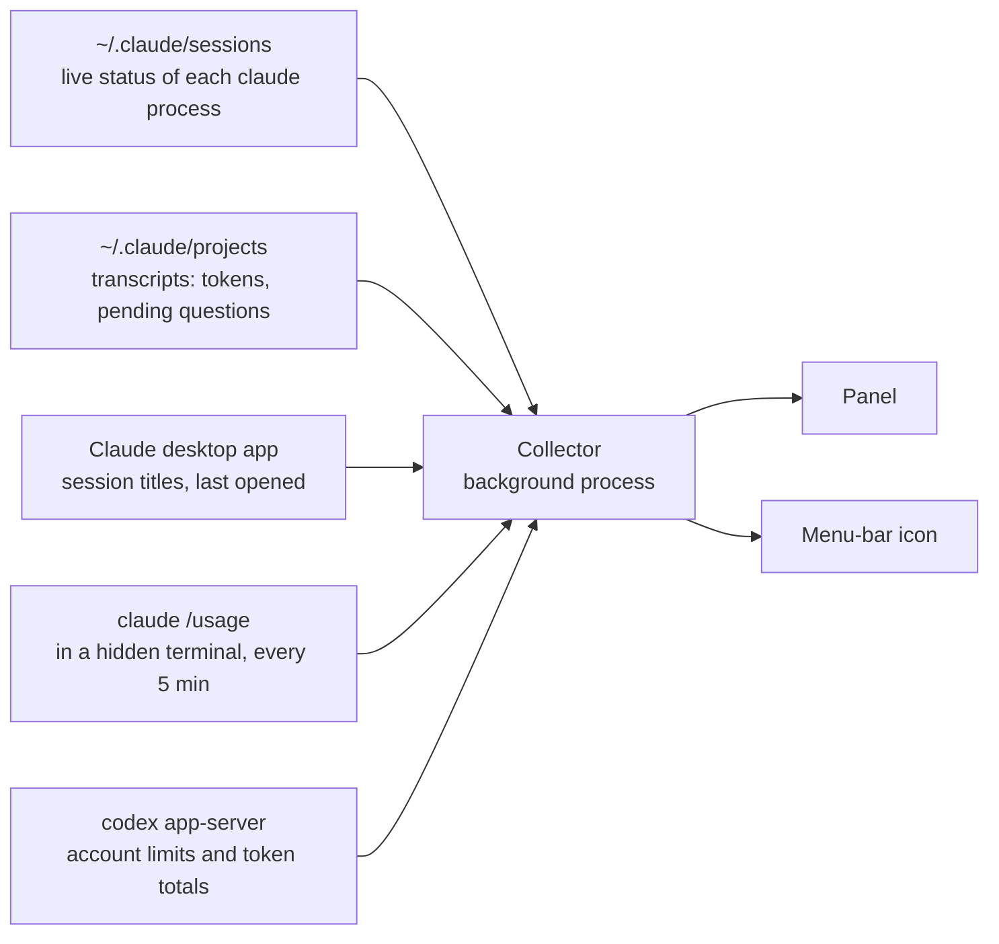

# Agent Pulse

**A tiny always-on-top panel for your Mac that shows what every Claude Code session is doing, and which one is waiting for you.**

<p align="center">
  
</p>

If you run several Claude Code sessions at once, in a terminal, in the Claude desktop app and in VS Code, you end up clicking through them to find the one that stopped to ask you something. Agent Pulse keeps them all in one small panel at the edge of your screen, together with your plan limits and token usage, so no session sits waiting for long.

> Agent Pulse is an independent, unofficial project. It is not affiliated with, endorsed by or supported by Anthropic. Claude and Claude Code are trademarks of Anthropic, PBC, used here only to say what the app works with.

## Quick start

Paste this into Claude Code, and it builds and installs Agent Pulse for you:

```text
Install Agent Pulse for me. Clone https://github.com/andrei-pisklenov/agent-pulse into ~/agent-pulse and follow the Install section of its README. Check the requirements first, and ask me before you install anything system-wide. When you're done, check that Agent Pulse is running from /Applications.
```

Or start it from a terminal:

```bash
claude "Install Agent Pulse for me. Clone https://github.com/andrei-pisklenov/agent-pulse into ~/agent-pulse and follow the Install section of its README. Check the requirements first, and ask me before you install anything system-wide. When you're done, check that Agent Pulse is running from /Applications."
```

It takes a few minutes, most of them spent downloading Electron. To do it by hand, see [Install](#install).

## What it shows

- **Every session in one place.** Terminal `claude`, the Claude desktop app (Code tab) and the VS Code extension, grouped by what they need from you: *needs input*, *running*, *finished* (until you open it) and *idle*. Desktop sessions that ended in the last 24 hours are listed too.
- **Running Codex tasks.** Active turns from Codex Desktop appear under **Running**. Click a Codex row to open its chat.
- **What a waiting session is asking.** The question or the permission it needs, read from the end of its transcript. If it can wait, snooze it for 15 minutes.
- **Your plan limits.** The 5-hour session and weekly bars with their reset times, plus a pace forecast such as "runs out Thu 11:40" or "~84% at reset".
- **Codex in the vertical panel.** When a Codex CLI is available, the collapsed pill shows one limit for Claude and one for Codex. It prefers the 5-hour window and labels the fallback with its actual duration. Hover to see both providers’ available limits and reset times, plus Codex account token totals when available.
- **Usage providers.** Tick **Claude**, **Codex**, both or neither under **Usage providers** in the panel or menu bar menu. Unticked providers' limits and token counts are hidden and not fetched at all. Both are on by default, and the session list always shows every session.
- **Tokens and waiting time.** Tokens per session, today and this week, and how long sessions waited on you today.

Click a row to jump to that session. Desktop sessions open in the Claude app, VS Code sessions in VS Code, and terminal sessions bring their Terminal or iTerm tab to the front.

## Out of your way

At rest the panel shrinks to a small pill showing your limits and the three counts. Hover over it to see everything. Drag it anywhere: it snaps to screen edges and corners, and it stands upright on the sides.

<p align="center">
  
</p>

Snap it to the top or bottom of the screen and it becomes a strip:

<p align="center">
  
</p>

## The menu-bar crab

<p align="center">
  
</p>

A pixel crab in the menu bar tells you the same thing at a glance. The counts next to it are sessions that need input `!`, are running `▶` and have finished `✓`. It sleeps when there is nothing to do, looks puzzled when a session needs you, gets to work while sessions run, and waves when one of them needs you. Click it for a menu with your 5-hour and weekly limits, when they reset, and the sessions that need you.

<p align="center">
  
</p>

While sessions work, it dances. Pick your favourite under Menu bar → Crab → Dance:

<p align="center">
  
</p>

Prefer something calmer? There is also an octopus, a heartbeat line, twin limit rings, a spark, signal bars, or plain text. The icons are template images, so macOS tints them like its own.

## Quick switcher

Press ⌃⌥C for a Spotlight-style list of your sessions. Type to filter, press ↵ to open one, ⇥ to switch between all, waiting, running and unread, and ⌘S to snooze. ⌃⌥P always shows or hides the panel.

<p align="center">
  
</p>

## Make it yours

The glass theme follows macOS light and dark mode. If you prefer something denser, there is a terminal HUD theme too.

<p align="center">
  
  
</p>

You can also make rows compact, switch the strip to status segments or a thin ticker, keep a gap to the screen edge, sit over a side Dock, or use square corners. Agent Pulse can notify you and play a sound when a session needs input, play a sound when one finishes, and start at login. Everything is in the menu-bar menu. [docs/design-options.md](docs/design-options.md) explains why the defaults are what they are.

## How it works

Agent Pulse reads the files Claude Code and the Claude app already keep up to date. It asks each CLI for that provider’s plan limits.



| What | Where it comes from |
| --- | --- |
| Live status | `~/.claude/sessions/<pid>.json`, which every running Claude Code process writes (`busy` / `waiting` / `idle`) |
| Running Codex tasks | Reads thread titles and turn status from the local Codex Desktop databases. A turn with no recorded activity for 30 minutes drops off the list to clear entries left behind by an interrupted app. |
| Desktop titles, "opened since finished" | `~/Library/Application Support/Claude/claude-code-sessions/**/local_*.json` |
| Tokens | `message.usage` in `~/.claude/projects/**/*.jsonl`, read incrementally; subagents count toward their parent |
| Plan limits | Starts `claude` in a hidden pseudo-terminal, types `/usage` and reads the screen. It uses Claude Code's own sign-in, spends no model tokens and writes no transcript. |
| Codex plan limits and usage | Uses the installed Codex CLI (including the one bundled in the ChatGPT app when available) and its existing sign-in. It asks for the main Codex quota and account token totals on the limit refresh schedule. |

Token counts leave out cache reads by default, because they dwarf everything else. Switch this under **Token counts** in the menu.

**Privacy:** Claude transcripts and local token counts stay on your Mac. The Codex CLI contacts OpenAI to read account limits and aggregate token usage, which can include usage from other devices. Agent Pulse does not read Codex credentials or send conversation content.

## Install

You need:

- macOS 13 Ventura or later, on Apple Silicon. Intel Macs should work but are untested: the build lands in `release/mac/` instead of `release/mac-arm64/`, and `yarn install-app` picks the right one.
- Git. If it's missing, macOS offers to install the Xcode Command Line Tools the first time you run `git`.
- Node.js 22.12 or later, with Corepack enabled (`corepack enable`), which provides the pinned Yarn version. Node 25 and later no longer include Corepack, so run `npm install -g corepack` first.
- Claude Code, installed and signed in.

Then build and install it:

```bash
git clone https://github.com/andrei-pisklenov/agent-pulse.git
cd agent-pulse
yarn install
yarn install-app
```

`yarn install-app` builds `Agent Pulse.app`, copies it to `/Applications` and starts it. If Agent Pulse is already running, it quits it first: the installed app, a packaged copy, or this checkout's `yarn dev` build. It touches nothing else.

When it's done, the crab appears in the menu bar. To check from a terminal that the installed copy is the one running:

```bash
pgrep -fl "/Applications/Agent Pulse.app"
```

To update, pull and install again:

```bash
git pull && yarn install && yarn install-app
```

To uninstall, switch off **Launch at login** in the menu if it's on, quit Agent Pulse, and delete `/Applications/Agent Pulse.app`. Its settings and state are in `~/Library/Application Support/agent-pulse`; delete that folder too to remove them.

A few things to know:

- **It's unsigned.** There is no prebuilt download, and the app you build isn't signed or notarized. A copy you build yourself opens normally. If you copy it to another Mac, Gatekeeper will block it until you allow it in System Settings → Privacy & Security.
- **Permissions.** macOS asks for **Automation** access the first time the app brings a Terminal or iTerm tab to the front, and for **Notifications** the first time it alerts you. The app also registers the global shortcuts ⌃⌥C and ⌃⌥P.
- **Launch at login** only works for the installed app. Switch it on in the menu; macOS lists it under System Settings → General → Login Items.
- **Settings** live in `~/Library/Application Support/agent-pulse/settings.json`.

## Good to know

- **Undocumented internals.** Agent Pulse depends on details that Anthropic doesn't document: the session files, the desktop app's session store, the `claude://code/continue` link (found by trying it out) and the layout of the `/usage` screen. A Claude update can break any of them without notice.
- **The `/usage` probe** is a real `claude` process, started in its own empty folder (`~/Library/Application Support/agent-pulse/probe`). On the first run it accepts Claude Code's "trust this folder" prompt for that folder only.
  - Like any `claude` start, it loads your settings, hooks and MCP servers.
  - It sets `AGENT_PULSE_PROBE=1`, so a hook can skip it with `[ -n "$AGENT_PULSE_PROBE" ] && exit 0`.
  - To run it less often, set `limitsRefreshMinutes` in the settings file.
- **Finding `claude`.** The app looks for `claude` in `~/.local/bin`, `~/.claude/local`, `/opt/homebrew/bin` and `/usr/local/bin`, then on your login shell's `PATH`.

## Development

```bash
yarn dev                 # run with hot reload
yarn test                # unit tests for the collectors
yarn lint                # ESLint is also the formatter (yarn lint:fix)
yarn typecheck
yarn snapshot --limits   # print what the collector sees right now
yarn package             # unsigned Agent Pulse.app in release/
yarn media               # re-render the screenshots and GIFs in docs/media
```

`yarn media` runs the real panel on a mock desktop with made-up sessions (`scripts/media/`), so the pictures never show your own work. It needs `ffmpeg` for the GIFs.

```
src/core       collectors, /usage probe, status tracking (plain Node, no Electron; tests in test/)
src/main       Electron main process (window, snapping, tray, hotkeys) and the collector's utility process
src/preload    bridge between main and renderer
src/renderer   React panel, quick switcher and menu-bar icon drawing
src/shared     settings and IPC types used by main and renderer
```

## License

[MIT](LICENSE)
